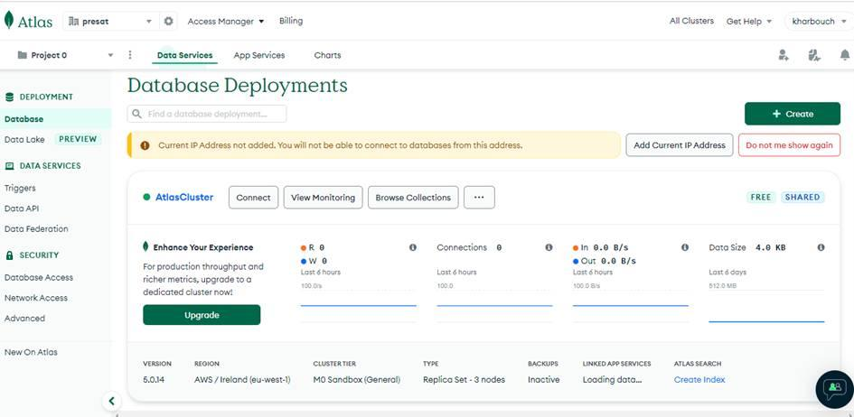
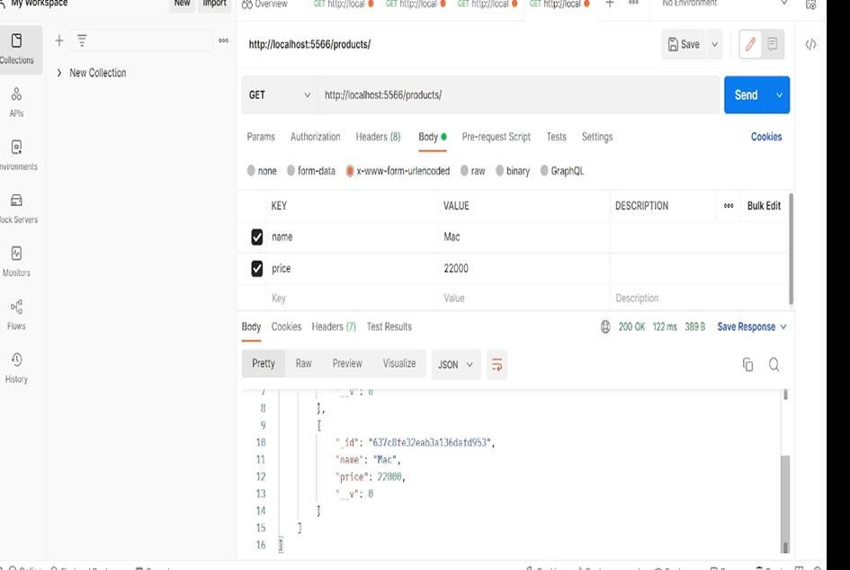

# ⚙️ Node.js & MongoDB REST API

Conception et développement d'une **API REST backend** robuste, scalable et performante construite avec l'environnement d'exécution **Node.js** et le framework **Express**, utilisant **MongoDB** comme base de données NoSQL via l'ODM Mongoose.

---

## 📊 Aperçu du Cloud Database & Validation API

### 🗄️ Déploiement sur MongoDB Atlas
Le projet utilise un cluster hébergé sur le Cloud MongoDB Atlas, gérant la collection dynamique des produits.


### 🧪 Tests d'Intégration Terminés avec Succès sur Postman
Validation de l'endpoint d'extraction des données (`GET /products/`) retournant le catalogue au format JSON avec un statut de succès HTTP `200 OK`.


---

## 🚀 Fonctionnalités & Architecture

* **🏗️ Architecture 3-Tier (MVC / Services)** : Séparation stricte des responsabilités entre les Modèles (Mongoose), les Services (Logique métier), et les Contrôleurs (Gestion des requêtes HTTP) pour garantir la maintenabilité.
* **🔌 Opérations Asynchrones** : Utilisation intensive du modèle asynchrone JavaScript (`async/await`) pour optimiser le traitement simultané des requêtes.
* **🔒 Sécurisation des Données** : Isolation de la chaîne de connexion de la base de données cloud Atlas à l'aide de variables d'environnement centralisées (`.env`).

## 🛠️ Stack Technique

* **Runtime :** Node.js
* **Framework Backend :** Express.js
* **Base de Données :** MongoDB Atlas & Mongoose ODM
* **Gestion des Configurations :** Dotenv
* **Outil de Test :** Postman API Platform

## 📁 Structure Globale du Projet

```text
├── controllers/     # Logique des requêtes (productsControllers.js)
├── models/          # Schémas et structures Mongoose (Product.js)
├── routes/          # Définition des endpoints HTTP (produtsRoutes.js)
├── services/        # Traitement de la couche métier (productService.js)
├── .env.example     # Modèle des configurations masquées
└── app.js           # Point d'entrée et configuration de l'application
```
